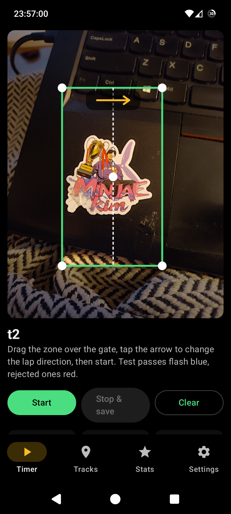

# FPV Lap Timer (Android)

A native Android lap timer for FPV drones that uses only the phone's camera: put the phone next to
the start gate and it detects the drone flying through it. It started as a port of the
[RaceGow CAM Timer](https://github.com/xviper25/RaceGow_CAM_Timer) web page.

<p align="center">
  
</p>

## Features

- **Gate crossing detection**: the detection zone is split by a gate line, and a lap only counts
  when motion crosses it in the chosen direction (left → right, right → left, either, or the
  legacy "any motion" mode). People walking by or the drone flying back don't trigger laps.
- **Camera choice**: pick any camera the phone exposes (front, main, ultra-wide, tele…) and its
  frame rate (60 fps where supported, for fast drones).
- **Spoken lap times** with the phone's own text-to-speech engine, **in French by default**
  ("Tour 3, 12,34 secondes"), English or the system language.
- **Screen stays on** while the app is open.
- **Tracks** with their own zone and lap history, **stats** with best lap, best 3 consecutive laps
  and a progression chart.
- True black theme to save battery on OLED screens, and sliders for all numeric settings.

## Getting started

1. **Install** the APK from the latest [GitHub release](../../releases) (allow installing from
   unknown sources when asked). Each new release installs over the previous one and keeps your data.
2. **Place the phone** beside the start gate so the camera sees the gate from the side, not head-on.
3. **Set the zone** on the Timer tab: drag the box corners and edges so the zone covers a bit in
   front of and behind the gate, and drag the dashed gate line onto the gate. Pick the lap
   direction in Settings → Detection; the arrow on the preview shows it.
4. **Test** before flying: with the timer stopped, a valid pass flashes blue and a rejected one red.
5. **Start** the timer. The first pass starts lap 1, each following pass records a lap.
   **Stop & save** stores the session in the track's stats.

### Tuning

- **Sensitivity**: lower it if passes are missed, raise it if shadows or wind trigger laps.
- **Minimum lap time**: increase it if one pass produces several laps.
- **Frame rate**: use the highest the camera offers; at 30 fps a fast drone may only show up in
  2–3 frames.
- **Show detection debug** draws live activity bars for each half of the zone and the motion
  centre, to see what the detector sees.

## Development

The app is Kotlin + Jetpack Compose (Material 3), CameraX, Room and DataStore.

```
core/   Pure Kotlin detection and timing logic (motion detector, crossing detector, lap timer,
        stats, spoken phrases), unit-tested without the Android SDK
app/    Android app: camera, text-to-speech, storage and the four tabs (Timer, Tracks, Stats, Settings)
```

Run the core tests (needs only a JDK 17 or 21):

```
./gradlew --configure-on-demand :core:test
```

Building the app locally needs the Android SDK (`ANDROID_HOME` or `local.properties`) and JDK 17
or 21:

```
./gradlew assembleRelease
adb install -r app/build/outputs/apk/release/app-release.apk
```

### CI and releases

`.github/workflows/build.yml` runs on every push to `main`: it runs the tests, builds the signed
release APK and publishes it as GitHub release `v1.0.<run number>`. Pull requests are built and
tested without a release.

### Signing

The release key (`signing/release.jks`) and its passwords (`signing/keystore.properties`) are
committed on purpose so CI needs no secrets and every build has the same signature. The
trade-off: anyone who can read this repository can sign an APK that installs as an update of the
app. If that ever matters (for example if the repository is public), move the key to GitHub
secrets and rotate it.

## License

Licensed under the [Apache License, Version 2.0](LICENSE).
